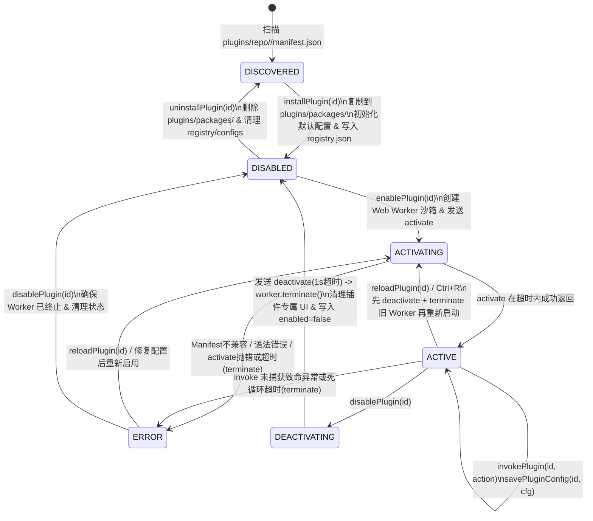

# Antigravity Mod (AGM) 插件插座与管理中心架构设计文档

- **文档版本**：v2.1.0（插件插座与管理中心架构设计）
- **目标环境**：`C:\Antigravity_Mod\`（便携隔离版）
- **隔离边界**：官方原版安装目录（`%OFFICIAL_APP_DIR%\`）及其运行中进程、`%USERPROFILE%\.gemini\`、`%APPDATA%\Antigravity`、`%LOCALAPPDATA%\antigravity-updater\`
- **设计原则**：100% 复用既有 `HakimiPluginHost` 薄插座总线架构，保留 `AGM_UPDATE_LOCK`、`AGM_SIDECAR_REAPER`、`hakimi-i18n` 与 `ai-sidedock` 全部既有行为。
- **仓库路径与运行时路径**：Git 源码在 `platform/`（宿主、`config.default.json`、`mod_kit/`、`scripts/`）、`plugins/builtin/<id>/` 与 `plugins/optional/<id>/`。下文带 `C:\Antigravity_Mod\` 的路径是安装后的运行时布局。安装脚本仍把源码复制到这些历史位置（顶层 `plugins\*.js`、`plugins\hakimi-i18n\`、`plugins\repo\`、`mod_kit\`），只复制、不删除，因此加载与扫描路径保持有效。用户数据（`UserData\`、`plugins\config.json`、`plugins\state\`、`plugins\packages\`）不在复制范围内。

---

## 1. 现役架构实现盘点（含精确 `file:line` 溯源）

通过对 `C:\Antigravity_Mod\mod_kit\`、`C:\Antigravity_Mod\plugins\` 以及 `resources\app.asar` 解包后的 `dist\` 源码核验，现役插件系统架构如下：

### 1.1 补丁注入链路（`mod_kit\patch.js`、`mod_kit\agm_locks.js`、`mod_kit\repatch.ps1`）
1. **重铸入口（`C:\Antigravity_Mod\mod_kit\repatch.ps1`，支持可选 `-TargetAppDir`/`-AppDir`）**：
   - 先核验 `resources\`、`patch.js`、`node`、`asar`（或回退 `npx asar`）及 `app.asar.bak`，再通过 `Get-CimInstance Win32_Process` 检查目标根目录下是否有运行中进程，若有则列出 PID 并以退出码 `3` 中止（绝不调用全局 `Stop-Process`）。
   - 从纯净备份 `resources\app.asar.bak`（若存在 `app.asar.unpacked` 且缺失 `app.asar.bak.unpacked`，则在临时区配对后解包）解包至 `%TEMP%\agm_rp_src_<时间戳>`，并显式校验 `$LASTEXITCODE`。
   - 执行 `node "$PatcherJs" "$TempSrc" --update-yml (Join-Path $ResourcesDir "app-update.yml")`，并对 6 个注入 JS 文件显式执行 `node --check`。
   - 先打包至暂存目录 `resources\.agm_repatch_tmp_<时间戳>\app.asar`（保持 `--unpack "**/chrome-devtools-mcp/**"`）并校验 `$LASTEXITCODE`、非零大小、`asar list` 必含 6 个注入文件及 SHA256；全部通过后先备份 `resources\app.asar.prev_<时间戳>` 再以 `Move-Item` 原子替换并复验 SHA256。任意失败自动清理临时目录并保持原 `app.asar` 不变。
2. **AGM 安全锁预检与注入（`C:\Antigravity_Mod\mod_kit\agm_locks.js:43-149` & `patch.js:21-31, 412-419`）**：
   - `agmLocks.preflight(targetDir)` 在写入任何文件前强校验 14 个正则锚点（`dist/updater.js` `U1`–`U7` 共 7 处、`dist/ipcHandlers.js` `I1`–`I3` 共 3 处、`dist/languageServer.js` `R1`–`R4` 共 4 处），每个锚点必须精确命中 1 次，否则以退出码 `2` 终止构建（`agm_locks.js:99-114`）。
   - `agmLocks.apply(targetDir, ...)` 注入 `AGM_UPDATE_LOCK` 与 `AGM_SIDECAR_REAPER`（读取 `mod_kit\agm_sidecar_reaper_core.js`），并将 `resources\app-update.yml` 的 `updaterCacheDirName` 锁定为 `antigravity-mod-updater`、保持死地址 `http://127.0.0.1:9/agm-update-disabled/`（`agm_locks.js:116-148`）。
3. **主进程注入（`C:\Antigravity_Mod\mod_kit\patch.js:36-266` -> `dist\main.js`）**：
   - **便携 UserData 锁**：在 `requestSingleInstanceLock()` 前将 `userData` 重定向至 `C:\Antigravity_Mod\UserData`（`patch.js:39-56`，注入后位于 `dist\main.js`）。
   - **Session 响应头清洗**：注入 `configureHakimiSession(sess)`，清洗 `User-Agent` 中的 `Electron/` 与 `Antigravity/` 标识，剥离 `X-Frame-Options` 及 CSP `frame-ancestors`（`patch.js:61-93`，注入后位于 `dist\main.js`）。在 `app.on('session-created')` 及 `app.whenReady()`（针对 `defaultSession` 与 `persist:hakimi_gemini`、`persist:hakimi_gpt`、`persist:hakimi_grok`）中调用。
   - **Hakimi IPC 处理器**：注入 `registerHakimiIpcHandlers()`（`patch.js:95-223`，注入后位于 `dist\main.js`）。
4. **窗口参数注入（`C:\Antigravity_Mod\mod_kit\patch.js:271-275` -> `dist\utils.js`）**：
   - 开启 `devTools: true` 与 `webviewTag: true`。

### 1.2 现役 IPC 通道与 Preload API
| IPC 通道名称 (`ipcMain.handle`) | 源码位置 (`patch.js` / `dist\main.js`) | Preload 映射 (`window.hakimiHost`) (`dist\preload.js`) | 实际行为与路径安全机制 |
|---|---|---|---|
| `hakimi:get-plugins-dir` | `patch.js:98-100` / `dist\main.js` | `getPluginsDir()` | 返回 `path.join(path.dirname(process.execPath), 'plugins')`（即 `C:\Antigravity_Mod\plugins`） |
| `hakimi:list-plugins` | `patch.js:102-115` / `dist\main.js` | `listPlugins()` | 若 `plugins\` 不存在则递归创建；通过 `fs.readdirSync(pDir)` 仅返回**顶层** `.endsWith('.js')` 文件列表（不扫描子目录） |
| `hakimi:read-plugin` | `patch.js:117-129` / `dist\main.js` | `readPlugin(name)` | 使用 `path.basename(filename)` 剥离目录路径防穿越，读取 `plugins\<safeName>` UTF-8 源码，不存在则返回 `null` |
| `hakimi:read-config` | `patch.js:131-142` / `dist\main.js` | `readConfig()` | 读取并解析 `plugins\config.json`，不存在或异常时返回 `{}` |
| `hakimi:save-config` | `patch.js:144-162` / `dist\main.js` | `saveConfig(cfg)` | 读取现有 `plugins\config.json`，执行顶层浅合并 `{ ...current, ...config }` 并以 2 空格缩进写回磁盘 |
| `hakimi:launch-desktop-gpt` | `patch.js:164-222` / `dist\main.js` | `launchDesktopGpt()` | 检索本地候选路径或通过 PowerShell `Get-StartApps` 拉起 ChatGPT 桌面端应用 |

### 1.3 加载器流程、注册/初始化/卸载契约与热重载
1. **加载器启动（`patch.js:308-400` / `dist\preload.js`）**：
   - 仅在非远程窗口（`if (!isRemoteWindow)`）运行，由防重入锁 `let hakimiReloading = false` 保护。
   - 在 `DOMContentLoaded`（或 `document.readyState !== 'loading'` 时立即）触发 `initHakimiHost(false)`。
2. **`window.HakimiPluginHost` 注入与 `register` 契约（`dist\preload.js`）**：
   - 先通过 `hakimi:read-config` 和 `hakimi:list-plugins` 获取 `config` 与顶层 `*.js` 文件列表。
   - 通过 `webFrame.executeJavaScript(hostInitScript)` 向主世界（Main World）注入 `window.HakimiPluginHost`（`version: "1.1.0"`, `config`, `plugins: {}`, `register(name, pluginObj)`, `reloadPlugins()`, `reload()`；外部宿主加载后会进一步扩展至 `2.1.0`）。
   - **注册即同步初始化**：当插件调用 `window.HakimiPluginHost.register(name, pluginObj)` 时，宿主立即将 `pluginObj` 存入 `this.plugins[name]`，并**同步调用 `pluginObj.init(this.config)`**（外包 `try/catch`）。
   - 随后按 `files` 顺序循环调用 `hakimi:read-plugin` 并通过 `webFrame.executeJavaScript` 将每个插件包裹在 `(function() { try { ... } catch(err) { ... } })()` 中注入主世界执行。
3. **Teardown（卸载清理）契约与热重载（`dist\preload.js`）**：
   - 宿主本身未定义统一的 `pluginObj.teardown()` 调用，而是拦截 `Ctrl+R` / `Cmd+R`（不带 Shift）、`F5` 以及 `window` 上的 `'hakimi:reload-plugins'` 自定义事件，重新调用 `initHakimiHost(true)`。
   - 现役两个插件均通过全局约定函数在自身重新执行或 `init` 时主动清理上一实例：
     - **`C:\Antigravity_Mod\plugins\ai-sidedock.js`**：
       - 在 `ai-sidedock.js:815-822` 调用 `window.HakimiPluginHost.register('ai-sidedock', { name: 'AI Side-Dock Three-Titan', version: '1.1.0', init(cfg) { initSideDock(cfg); } })`。
       - `initSideDock` 开头（`ai-sidedock.js:512-518`）调用 `window.__hakimiSideDockTeardown()`；该函数定义于 `ai-sidedock.js:790-804`，负责停止拖拽、清除定时器、解绑 `window`/`resizer`/`trigger` 事件监听，同时复用已挂载的 `#hakimi-sidedock-root` 与 `<webview>` 节点以保持会话不断连（`ai-sidedock.js:544-565`）。
     - **`C:\Antigravity_Mod\plugins\hakimi-i18n.js`（由仓库源码 `plugins/builtin/hakimi-i18n/hakimi-i18n/build.js` 打包生成）**：
       - 顶层 IIFE 开头（`build.js:56-63`）立即检查并调用 `window.__hakimiI18nTeardown()`。
       - 在 `build.js:266-273`（产物 `hakimi-i18n.js:3335-3341`）调用 `window.HakimiPluginHost.register('hakimi-i18n', { name: 'Hakimi i18n Deep Localization Engine', version: '1.1.0', init(hostConfig) { initHakimiI18n(hostConfig); } })`。
       - `window.__hakimiI18nTeardown` 定义于 `build.js:175-184`，调用 `domAdapter.stop()`（断开 `MutationObserver` 并还原 history/shadowDOM/title hook）与 `configUI.destroy()`（移除 `#hakimi-i18n-modal-overlay`、`#hakimi-i18n-trigger`、`#hakimi-i18n-style` 及 `Ctrl+Shift+L` 监听，`plugins/builtin/hakimi-i18n/hakimi-i18n/ui/config-center.js:32-52`）。
       - 暴露全局调试句柄 `window.__HAKIMI_I18N__`（含 `restoreEnglish()`, `toggleUI()`, `runLiveAudit()`，`build.js:248-257` / `hakimi-i18n.js:3316-3325`）。
       - **DOM 免疫机制（`plugins/builtin/hakimi-i18n/hakimi-i18n/core/sanitizer.js:30-33, 84-90` & `discovery.js:180-199`）**：任何带有 `data-ag-localization-skip="true"`、`data-immune="true"` 或 `translate="no"` 属性的 DOM 节点及其子树，均被 `hakimi-i18n` 完全豁免（不进行翻译替换，也不录入未翻译发现库）。

### 1.4 `plugins\config.json` 结构与插件物理目录
- **`C:\Antigravity_Mod\plugins\config.json`（共 56 行）**：
  - `"sidedock"`（第 2–6 行）：`{ "width": 340, "collapsed": true, "activeTab": "gemini" }`。
  - `"i18n"`（第 7–55 行）：`{ "enabled": true, "language": "zh-CN", "preset": "full", "scope": { ... }, "customOverrides": { ... }, "exclusions": [ ... ], "glossary": { ... } }`（注：`exclusions` 中含用户私有白名单项，严禁外泄或破坏）。
- **物理存储位置**：
  - 现役运行时插件位于 `C:\Antigravity_Mod\plugins\ai-sidedock.js` 与 `C:\Antigravity_Mod\plugins\hakimi-i18n.js`。
  - `C:\Antigravity_Mod\plugins\hakimi-i18n\` 为模块化源码与词典目录（含 `build.js`、`core\sanitizer.js`、`core\discovery.js`、`core\engine.js`、`adapters\dom-adapter.js`、`ui\config-center.js`、`locales\zh-CN\*.json`、`custom\*.json`），因非顶层 `.js` 文件，不会被 `hakimi:list-plugins` 直接注入。

---

## 2. 架构冲突评估 (CONFLICT ASSESSMENT)

**结论：`NO MAJOR CONFLICT`**

### 评估依据
1. **薄插座 + 外部插件宿主与既有路线完全同构**：
   - 既有架构（见 `docs/WHITEPAPER.md` 第三章）本身就是 **“`app.asar` 内置轻量级 IPC 薄插座 + `C:\Antigravity_Mod\plugins\` 外置热插拔脚本”**。
   - 规格要求的“插件发现、安装、启停、生命周期、配置、权限校验、错误隔离、卸载”以及“真实可操作的插件中心（已安装/插件仓库/设置 + Schema 配置详情页）”，**完全无需推翻或重写既有路线**。
2. **零破坏增量演进路径**：
   - **`app.asar` 薄插座层**：保留全部 6 个既有 `hakimi:*` IPC 通道与 `window.hakimiHost` 方法、保留 `window.HakimiPluginHost.register` 同步兼容契约、保留 `AGM_UPDATE_LOCK` 与 `AGM_SIDECAR_REAPER`，仅在 `registerHakimiIpcHandlers()` 中增量补充 7 个严格限制在 `C:\Antigravity_Mod\plugins\` 目录内的文件/包管理与状态读写原语，并为 Hakimi 补丁锚点补齐与 `agm_locks.js` 一致的“锚点缺失即失败退出（exit 2）”强校验。
   - **外部插件宿主层（`asar` 之外）**：新增顶层 `C:\Antigravity_Mod\plugins\agm-plugin-host.js`（由既有加载器自动作为首个脚本加载），在渲染进程内原地升级 `window.HakimiPluginHost` 至 `v2.0.0`，统一接管传统主世界插件（`hakimi-i18n`、`ai-sidedock`）与新式沙箱包插件（`plugins\packages\<id>\` + `plugins\repo\<id>\`）的生命周期、Web Worker 沙箱隔离、权限网关拦截、Schema 表单校验与插件中心 UI。

---

## 3. 详细工程设计（复用既有路线）

### 3(a) `app.asar` 薄插座最小增量设计（由 `mod_kit\patch.js` 注入）

#### 1. 强锚点预检机制（Fail Loudly Like `agm_locks.js`）
在 `mod_kit\patch.js` 中新增 `preflightHakimiAnchors(mainJs, utilsJs, preloadJs)` 与注入后标记校验（Post-Check）：
- 写入任何文件前，校验以下 8 个锚点必须**精确命中 1 次**，否则打印 `[Patch][Hakimi] FATAL: anchor missing/ambiguous` 并以 `process.exit(2)` 退出：
  - `H_MAIN_1`: `const gotTheLock = electron_1.app.requestSingleInstanceLock();`
  - `H_MAIN_2`: `(0, customScheme_1.registerCustomSchemes)();`
  - `H_MAIN_3`: `electron_1.app.on('session-created', (targetSession) => {`
  - `H_MAIN_4`: `registerIpcHandlers(storageManager, { ... });` 块
  - `H_UTILS_1`: `webviewTag: builtInBrowser,`
  - `H_UTILS_2`: `devTools: (0, debugConsole_1.isDebugConsoleEnabled)(),`
  - `H_PRELOAD_1`: `electron_1.contextBridge.exposeInMainWorld('sshRemote', createLocalSshRemoteAPI());`
  - `H_PRELOAD_2`: `!preloadJs.includes('HakimiPluginHost Initializer')`
- `agmLocks.preflight(targetDir)` 与 `agmLocks.apply(targetDir, ...)` 保持 100% 原样不变。

#### 2. 路径安全与目录边界守卫（Confined to `C:\Antigravity_Mod\plugins\`）
在 `registerHakimiIpcHandlers()` 内部定义统一路径安全守卫，杜绝任何目录穿越或越界读写：
```javascript
const SAFE_ID_RE = /^[a-z0-9][a-z0-9._-]{0,63}$/i;
const assertSafeId = (id) => {
    if (typeof id !== 'string' || !SAFE_ID_RE.test(id) || id.includes('..')) {
        throw new Error('Invalid plugin ID: ' + String(id));
    }
    return id;
};
const resolveConfined = (baseDir, ...parts) => {
    const base = path.resolve(baseDir);
    const target = path.resolve(base, ...parts);
    if (target !== base && !target.startsWith(base + path.sep)) {
        throw new Error('Path traversal blocked: ' + target);
    }
    return target;
};
```
此外，`hakimi:list-plugins` 对返回的顶层 `.js` 文件列表进行确定性排序，确保外部宿主 `agm-plugin-host.js` 永远第一个加载：
```javascript
return files
    .filter(f => f.endsWith('.js'))
    .sort((a, b) => (a === 'agm-plugin-host.js' ? -1 : b === 'agm-plugin-host.js' ? 1 : a.localeCompare(b)));
```

#### 3. 新增 IPC 通道与 `window.hakimiHost` Preload 方法清单
在**完整保留**既有 6 个 IPC 通道（`hakimi:get-plugins-dir`、`hakimi:list-plugins`、`hakimi:read-plugin`、`hakimi:read-config`、`hakimi:save-config`、`hakimi:launch-desktop-gpt`）的前提下，新增以下 7 个 IPC 通道与对应 `window.hakimiHost` 方法：

| 新增 IPC 通道 | `window.hakimiHost` 方法签名 | 严格路径边界与行为规范 |
|---|---|---|
| `hakimi:get-host-info` | `getHostInfo()` | 返回 `{ appVersion: electron_1.app.getVersion(), electronVersion: process.versions.electron, nodeVersion: process.versions.node, pluginsDir: getPluginsDir(), hostSocketVersion: "2.0.0" }` |
| `hakimi:list-packages` | `listPackages(source)` | `source` 仅允许 `'repo'` 或 `'installed'`，分别对应 `plugins\repo\` 与 `plugins\packages\`（不存在则自动 `mkdirSync`）。遍历符合 `SAFE_ID_RE` 的子目录，读取 `<id>\manifest.json`，返回 `Array<{ id, source, manifest, valid, error }>` |
| `hakimi:read-package-entry` | `readPackageEntry(pluginId, entryRel)` | 校验 `assertSafeId(pluginId)`；通过 `resolveConfined(path.join(getPluginsDir(), 'packages', pluginId), entryRel)` 校验入口文件位于该插件包目录内且以 `.js` 结尾；返回 `{ ok: true, code }` 或 `{ ok: false, error }` |
| `hakimi:install-package` | `installPackage(pluginId)` | 校验 `assertSafeId(pluginId)`；验证源目录 `plugins\repo\<pluginId>\manifest.json` 存在、JSON 合法、`manifest.id === pluginId` 且入口文件存在；使用 `fs.lstatSync` 拒绝任何符号链接/Junction，将 `plugins\repo\<pluginId>` 递归复制至 `plugins\packages\<pluginId>`；返回 `{ ok: true, manifest }` |
| `hakimi:uninstall-package` | `uninstallPackage(pluginId)` | 校验 `assertSafeId(pluginId)`；定位 `target = resolveConfined(path.join(getPluginsDir(), 'packages'), pluginId)`；若存在则调用 `fs.rmSync(target, { recursive: true, force: true })` 删除已安装包目录；返回 `{ ok: true }` |
| `hakimi:read-state` | `readState(category, key)` | 限定在 `plugins\state\` 下读取：<br>- `category === 'registry'`：读取 `plugins\state\registry.json`（不存在返回 `{ version: 1, settings: {}, plugins: {} }`）<br>- `category === 'config'`：校验 `assertSafeId(key)`，读取 `plugins\state\configs\<key>.json`（不存在返回 `null`）<br>- `category === 'log'`：校验 `assertSafeId(key)`，读取 `plugins\state\logs\<key>.log`（不存在返回 `""`） |
| `hakimi:write-state` | `writeState(category, key, data)` | 限定在 `plugins\state\` 下写入（自动创建 `state\configs` 与 `state\logs`）：<br>- `category === 'registry'`：原子写入 `plugins\state\registry.json`<br>- `category === 'config'`：校验 `assertSafeId(key)`，`data === null` 时删除 `plugins\state\configs\<key>.json`，否则原子写入 JSON<br>- `category === 'log'`：校验 `assertSafeId(key)`，向 `plugins\state\logs\<key>.log` 追加单行日志（超过 128 KB 自动保留末尾 64 KB 防膨胀）<br>- `category === 'clear-log'`：清空 `plugins\state\logs\<key>.log` |

#### 4. `preload.js` 启动上下文预注入（支持同步拦截传统插件启停）
在 `preload.js` 的 `initHakimiHost(isReload)` 中，除了读取 `config = await ipcRenderer.invoke('hakimi:read-config')`，同时读取 `registry = await ipcRenderer.invoke('hakimi:read-state', 'registry', '')` 与 `hostInfo = await ipcRenderer.invoke('hakimi:get-host-info')`，并将其挂载到 `window.HakimiPluginHost.__bootContext = { config, registry, hostInfo, isReload }`。
这样当排在第一位的 `agm-plugin-host.js` 执行时，无需等待异步 IPC 即可**同步**拿到 `registry.plugins` 启停表并接管 `window.HakimiPluginHost.register`，确保排在后面的 `ai-sidedock.js` 和 `hakimi-i18n.js` 调用 `register()` 时立即受控。

---

### 3(b) 外部插件宿主设计（`C:\Antigravity_Mod\plugins\agm-plugin-host.js`）

`agm-plugin-host.js` 位于 `app.asar` 之外（`C:\Antigravity_Mod\plugins\agm-plugin-host.js`），由既有加载器自动注入，承担以下 6 项核心职责：
1. **宿主总线原地升级（`HakimiPluginHost v2.0.0`）**：
   - 保持 `window.HakimiPluginHost.config`、`window.HakimiPluginHost.plugins`、`register(name, pluginObj)`、`reloadPlugins()`、`reload()` 完全向后兼容。
   - 扩展标准宿主方法：`discoverAll()`、`installPlugin(id)`、`uninstallPlugin(id)`、`enablePlugin(id)`、`disablePlugin(id)`、`reloadPlugin(id)`、`invokePlugin(id, actionId, payload)`、`getPluginConfig(id)`、`savePluginConfig(id, values)`、`resetPluginConfig(id)`、`getPluginLogs(id)`、`clearPluginLogs(id)`、`openPluginCenter(tab, pluginId)`。
2. **传统主世界插件适配器（Legacy Adapter）**：
   - 为 `hakimi-i18n` 与 `ai-sidedock` 提供内置归一化描述元数据（名称、作者、版本、兼容性、权限清单、配置桥接），在 `register(name, pluginObj)` 被调用时根据 `registry.plugins[name].enabled` 决定是否执行 `pluginObj.init(config)`，并在禁用时执行对应的无损卸载清理函数。
3. **包插件发现、安装、兼容性校验与卸载**：
   - 对比 `plugins\repo\<id>\manifest.json` 与 `plugins\packages\<id>\manifest.json`，执行 Manifest 结构校验与 Semver 版本范围兼容性检查（`compatibility.appVersion`、`compatibility.hostVersion`）。
4. **配置 Schema 校验与持久化管理**：
   - 基于 `manifest.configSchema` 自动合成默认值、执行类型与约束校验（`boolean` / `string` / `number` / `enum`），读写 `plugins\state\configs\<id>.json`。
5. **Web Worker 沙箱运行时与超时熔断器**：
   - 为每个启用的包插件创建独立 `Blob` Web Worker，通过消息通道（`postMessage`）驱动 `activate`、`invoke`、`onConfigChange`、`deactivate` 生命周期，并对每次调用施加超时监控（默认 `2500 ms`），超时或死循环立即 `worker.terminate()`。
6. **权限网关（Permission Gatekeeper）与插件中心 UI**：
   - 拦截 Worker 发出的所有 `host:rpc` 请求，核对 `manifest.permissions`，拒绝并记录任何未授权调用；渲染插件中心 UI（已安装 / 插件仓库 / 设置 / 插件配置详情页）。

---

### 3(c) 插件包规范 (`manifest.json`) 与存储拓扑

#### 1. 目录存储拓扑（全部收敛于 `C:\Antigravity_Mod\plugins\`）
```text
C:\Antigravity_Mod\plugins\
├── config.json                         # 既有配置文件（仅含 sidedock 与 i18n，绝不混入新键）
├── agm-plugin-host.js                  # 外部插件宿主 + 插件管理中心 UI（新建，首个加载）
├── ai-sidedock.js                      # 既有三巨头侧边舱插件（保持原样）
├── hakimi-i18n.js                      # 既有汉化引擎产物（保持原样）
├── hakimi-i18n\                        # 既有汉化引擎模块化源码与词典（保持原样）
├── repo\                               # 本地插件仓库源目录（待发现/待安装插件包）
│   ├── agm-hello-guard\                # 标准安全示例插件源包
│   │   ├── manifest.json
│   │   └── index.js
│   └── agm-fault-probe\                # 异常隔离与死循环熔断测试插件源包（测试用）
│       ├── manifest.json
│       └── index.js
├── packages\                           # 已安装插件包目录（由 install 从 repo\<id> 安装至此）
│   └── <pluginId>\
│       ├── manifest.json
│       └── index.js
└── state\                              # 宿主状态、独立配置与独立日志目录
    ├── registry.json                   # 插件启停状态、安装元数据与宿主全局设置
    ├── configs\
    │   └── <pluginId>.json             # 单插件独立配置与私有 KV 存储 ({ config, storage })
    └── logs\
        └── <pluginId>.log              # 单插件持久化运行、生命周期与权限审计日志
```
> **红线说明**：不向 `C:\Antigravity_Mod\plugins\config.json` 写入任何新顶层字段，确保 `hakimi-i18n` 与 `ai-sidedock` 读写 `config.json` 的逻辑以及其中的用户私有数据 100% 零干扰。

#### 2. `manifest.json` 字段规范与 `configSchema` 校验规则
| 字段名 | 类型 | 必填 | 校验规则与说明 |
|---|---|---|---|
| `manifestVersion` | `number` | 是 | 固定为 `1` |
| `id` | `string` | 是 | 匹配 `/^[a-z0-9][a-z0-9._-]{1,63}$/`，且必须与包文件夹名称一致 |
| `name` | `string` | 是 | 插件显示名称（1~64 字符） |
| `author` | `string` | 是 | 作者或团队名称（1~64 字符） |
| `version` | `string` | 是 | 语义化版本号，匹配 `/^\d+\.\d+\.\d+(-[\w.]+)?$/` |
| `description` | `string` | 否 | 插件功能简述 |
| `compatibility` | `object` | 是 | `{ "appVersion": ">=1.0.0", "hostVersion": ">=2.0.0" }`，支持 `>=`, `^`, `=`, `*` 语义版本范围对比（与 `hostInfo.appVersion` 及 `HakimiPluginHost.version` 比对） |
| `entry` | `string` | 是 | 包内相对 JS 路径（如 `"index.js"`），禁止 `..` 或绝对路径 |
| `permissions` | `string[]` | 是 | 声明所需的权限标识符数组（如 `["ui:toast", "ui:banner", "config:read", "storage:read", "storage:write"]`） |
| `actions` | `array` | 否 | 可在插件中心/详情页直接触发的动作列表：`Array<{ id: string, label: string, description?: string }>` |
| `configSchema` | `object` | 是 | 键为配置项名，值为字段 Schema 定义，支持 4 种基础类型与校验约束（见下表） |

**`configSchema` 四种字段类型与校验规则**：
1. **`boolean`（开关）**：
   - Schema 属性：`{ type: "boolean", title: string, description?: string, default: boolean }`
   - 校验规则：`typeof val === 'boolean'`。
2. **`string`（文本）**：
   - Schema 属性：`{ type: "string", title: string, description?: string, default: string, required?: boolean, minLength?: number, maxLength?: number, pattern?: string }`
   - 校验规则：`typeof val === 'string'`；若 `required: true` 则 `val.trim().length > 0`；校验 `val.length >= minLength`、`val.length <= maxLength`；若声明 `pattern` 则 `new RegExp(pattern).test(val)` 必须为 `true`。
3. **`number`（数字）**：
   - Schema 属性：`{ type: "number", title: string, description?: string, default: number, required?: boolean, min?: number, max?: number, integer?: boolean }`
   - 校验规则：`typeof val === 'number' && Number.isFinite(val)`；若 `integer: true` 则 `Number.isInteger(val)`；校验 `val >= min` 且 `val <= max`。
4. **`enum`（枚举）**：
   - Schema 属性：`{ type: "enum", title: string, description?: string, default: string, options: Array<{ value: string, label: string } | string> }`
   - 校验规则：`val` 必须严格等于 `options` 中定义的某个候选 `value`。

---

### 3(d) 插件生命周期状态机与错误处理



**各阶段异常与边界处理规范**：
1. **Discover（发现）**：若 `repo\<id>\manifest.json` JSON 损坏或字段缺失，状态标为 `MANIFEST_INVALID`，在仓库列表展示具体解析错误并禁用“安装”按钮，不影响其他插件发现。
2. **Install（安装）**：安装前先执行 `checkCompatibility(manifest.compatibility, hostInfo)`；若版本不兼容则拒绝安装并在 UI 提示不兼容原因。文件复制失败时回滚清理 `packages\<id>` 半成品目录。
3. **Enable / Activate（启用与激活）**：在 Worker 中加载 `entry` 脚本并调用 `plugin.activate(context)`，受 `executionTimeoutMs`（默认 `2500 ms`）保护。若抛错或超时，宿主立即调用 `worker.terminate()` 回收线程，将该插件置为 `ERROR` 状态并记录 `lastError` 到 `state\logs\<id>.log`。
4. **Invoke（调用）**：仅允许对 `ACTIVE` 状态的插件发起 `invoke(actionId, payload)`。若调用过程中同步抛错或 Promise reject，Worker 捕获异常并回传错误对象，宿主记录 `[ERROR]` 日志并在详情页展示错误反馈；若插件陷入死循环（如 `while(true){}`）导致超时，宿主立即调用 `worker.terminate()`，将插件置为 `ERROR` 状态，主界面与其他插件零卡顿。
5. **Config Save（配置保存）**：先走 `validateConfigBySchema(schema, rawValues)`。校验不通过时返回 `{ ok: false, errors: { [field]: "错误原因" } }`，绝不写盘，UI 高亮对应表单项；校验通过后写入 `state\configs\<id>.json`，并向处于 `ACTIVE` 状态的插件推送 `onConfigChange(newConfig)`。
6. **Reload（重载）**：先对运行中的插件执行 `deactivate`（1 秒超时）+ `worker.terminate()`，清除该插件挂载的横幅/状态数据，再从磁盘重新读取代码与 `state\configs\<id>.json` 重新执行 `activate`。
7. **Disable（禁用）**：持久化 `registry.plugins[id].enabled = false`，执行 `deactivate` + `worker.terminate()`，清理该插件产生的所有 UI 状态横幅，状态置为 `DISABLED`。
8. **Uninstall（卸载）**：若插件处于 `ACTIVE` 或 `ERROR` 状态，先强制执行 `disablePlugin(id)` 确保 Worker 线程彻底销毁，随后调用 `hakimiHost.uninstallPackage(id)` 删除 `plugins\packages\<id>`，移除 `registry.plugins[id]` 与 `state\configs\<id>.json`。

---

### 3(e) 权限模型设计（声明、展示、API 边界强制拦截与诚实边界）

#### 1. 权限清单与 API 边界映射表
| 权限标识符 (`manifest.permissions`) | 权限中文名称 | 对应沙箱 RPC API (`context.api.*`) | 风险等级 |
|---|---|---|---|
| `ui:toast` | 弹出轻量通知 | `api.ui.showToast(message, level)` | 低 |
| `ui:banner` | 更新插件状态横幅 | `api.ui.setBanner(text, style)` | 低 |
| `config:read` | 读取本插件配置 | `api.config.get(key)` / `api.config.getAll()` | 低 |
| `config:write` | 修改本插件配置 | `api.config.set(key, value)`（需通过 Schema 校验） | 中 |
| `storage:read` | 读取插件私有存储 | `api.storage.get(key)` | 低 |
| `storage:write` | 写入插件私有存储 | `api.storage.set(key, value)`（单插件上限 64 KB） | 低 |
| `clipboard:read` | 读取系统剪贴板 | `api.clipboard.readText()` | 中 |
| `clipboard:write` | 写入系统剪贴板 | `api.clipboard.writeText(text)` | 中 |
| `shell:launchDesktopGpt` | 拉起外部桌面 GPT 应用 | `api.shell.launchDesktopGpt()` | 高 |

#### 2. 为什么这是真实的权限强制执行（Real Enforcement）
1. **物理上下文隔离**：新式包插件运行在独立的 `Blob` **Web Worker** 线程中，Worker 全局作用域内不存在 `window`、`document`、`electron`、`ipcRenderer` 或 `window.hakimiHost`。
2. **封闭网络与子线程构造器**：在 Worker 引导脚本（Bootstrap）加载插件代码前，显式冻结并移除危险全局对象：
   ```javascript
   ['fetch', 'XMLHttpRequest', 'WebSocket', 'EventSource', 'Worker', 'SharedWorker', 'importScripts'].forEach(k => {
       try { Object.defineProperty(self, k, { value: undefined, writable: false, configurable: false }); } catch (_) { self[k] = undefined; }
   });
   ```
3. **宿主 RPC 边界强校验（不可伪造身份）**：
   - Worker 只能通过 `self.postMessage({ type: 'host:rpc', callId, capability, args })` 请求宿主能力。
   - 宿主在创建该 `Worker` 实例的闭包中绑定了不可篡改的 `pluginId` 与 `manifest.permissions` 集合。
   - 收到任何 `host:rpc` 请求时，宿主网关在调用底层实现前先执行：
     ```javascript
     const requiredPerm = CAPABILITY_TO_PERMISSION[capability];
     if (!requiredPerm || !grantedPermissions.has(requiredPerm)) {
         const msg = `[PermissionDenied] 插件 "${pluginId}" 调用 "${capability}" 被拒绝：未声明权限 "${requiredPerm || 'unknown'}"`;
         this.recordPermissionDenial(pluginId, capability, requiredPerm, msg);
         worker.postMessage({ type: 'host:rpc-reply', callId, ok: false, code: 'E_PERMISSION_DENIED', error: msg });
         return;
     }
     ```
   - 被拒绝的调用绝不会触达 `window.hakimiHost` 或 DOM，同时立即写入 `plugins\state\logs\<pluginId>.log` 并累加该插件的 `越权拦截次数`。

#### 3. 权限模型的诚实边界说明
- **沙箱插件（`plugins\packages\<id>`）**：受 Web Worker 线程隔离与宿主 RPC 权限网关严格约束，无法直接触碰 DOM、`window.hakimiHost` 或发起网络请求。但需诚实说明：Web Worker 是渲染进程内的线程级能力沙箱，而非操作系统级独立进程容器。
- **传统主世界插件（`hakimi-i18n`、`ai-sidedock`）**：因业务本身必须全量扫描/修改主页面 DOM（`MutationObserver`）或挂载 Electron `<webview>` 标签，它们运行在渲染层主世界（Main World），天然拥有 `window` 与 `window.hakimiHost` 访问权。插件中心对其明确标记为 **`[内置主世界插件 — 无 Worker 沙箱隔离]`**，绝不伪造其受沙箱限制的假象。

---

### 3(f) 错误隔离模型与传统插件兼容治理

#### 1. 新式插件 Web Worker 错误隔离与死循环熔断机制
每个启用的包插件运行在由 `URL.createObjectURL(new Blob([workerBootstrapCode], { type: 'application/javascript' }))` 创建的独立 `Worker` 中：
1. **同步异常与异步 Promise Reject 隔离**：
   - Worker 内部用 `try { await fn(...) } catch (err) { ... }` 包裹所有生命周期钩子（`activate`、`invoke`、`onConfigChange`、`deactivate`），同时监听 `self.onerror` 与 `self.onunhandledrejection`。
   - 任何代码抛错均被序列化为 `{ ok: false, error: err.message, stack: err.stack }` 回传宿主，宿主将其记录到 `state\logs\<id>.log` 并在详情页展示错误横幅，主窗口 UI 与其他插件不受任何影响。
2. **死循环（`while(true){}`）与卡死超时强制熔断**：
   - 由于 Web Worker 运行在独立的 Chromium 操作系统线程上，即使插件内部执行 `while(true){}` 死循环，**主窗口 UI 渲染线程也完全不会卡死**。
   - 宿主对每一次发往 Worker 的生命周期/动作消息启动定时器（`timeoutMs = registry.settings.executionTimeoutMs || 2500`）。
   - 一旦超时未收到 Worker 回复：
     1. 宿主立即调用 `worker.terminate()` —— 在引擎底层直接杀死该 Worker 线程，立即释放 CPU。
     2. 宿主将该插件状态置为 `ERROR`，记录 `lastError = "执行超时 (2500ms)，已强制终止沙箱线程 (worker.terminate)"`。
     3. 写入持久化日志 `[ERROR] [isolation] Worker terminated after 2500ms timeout`。
     4. 清理该插件关联的临时状态横幅，IDE 主界面与其余插件继续流畅运行。

#### 2. 传统主世界插件（`hakimi-i18n`、`ai-sidedock`）的展示与诚实启停控制
在插件中心“已安装”列表中，`hakimi-i18n` 与 `ai-sidedock` 作为 **`内置核心 / 主世界 (Legacy Main-World)`** 插件展示：
- **支持且真实生效的操作**：
  1. **动态启用 / 禁用（持久化至 `state\registry.json`，跨重载与重启生效）**：
     - **`hakimi-i18n` 禁用**：宿主调用 `window.__HAKIMI_I18N__?.restoreEnglish()` 将全界面已汉化文本无损还原为原始英文，再调用 `window.__hakimiI18nTeardown()` 停止 `MutationObserver` 并销毁右下角 `🐾 中/EN` 胶囊与弹窗，状态置为 `DISABLED`。
     - **`hakimi-i18n` 启用**：重新调用其注册的 `init(HakimiPluginHost.config)`，立即恢复 `🐾 中/EN` 胶囊并对界面执行汉化，状态置为 `ACTIVE`。
     - **`ai-sidedock` 禁用**：宿主调用 `window.__hakimiSideDockTeardown()`，将 `#hakimi-sidedock-root` 与 `#hakimi-sidedock-trigger` 设为 `display: none`，并将 `document.documentElement.style.setProperty('--hakimi-dock-offset', '0px')` 归零（主会话区恢复 100% 宽度，同时不销毁已挂载的 `<webview>` 节点以保护登录态），状态置为 `DISABLED`。
     - **`ai-sidedock` 启用**：恢复 `#hakimi-sidedock-root` / `#hakimi-sidedock-trigger` 显示并调用其 `init(HakimiPluginHost.config)` 恢复侧边舱与宽度偏移，状态置为 `ACTIVE`。
  2. **配置联动与详情页**：
     - 在详情页完整展示其版本 (`1.1.0`)、作者 (`Hakimi Tech Lab`)、权限列表、运行状态与宿主日志。
     - `hakimi-i18n` 详情页提供 Schema 表单（`enabled` 开关、`language` 语言枚举、`preset` 预设枚举，保存时同步写回 `plugins\config.json` 的 `i18n` 段并刷新引擎）以及一键唤起原版 6 页签词典配置中心按钮（`window.__HAKIMI_I18N__.toggleUI()`）。
     - `ai-sidedock` 详情页提供 Schema 表单（`width` 宽度数字 `340~900`、`collapsed` 默认收起开关、`activeTab` 默认标签枚举 `gemini/gpt/grok`，保存时同步写回 `plugins\config.json` 的 `sidedock` 段并立即应用）。
- **诚实禁止的操作**：
  - **禁止卸载**：卸载按钮置灰并标注 `核心内置 (不可卸载)`，以保持 `hakimi-i18n` 与 `ai-sidedock` 完好可用。

---

### 3(g) 插件管理中心 UI 设计（与 `hakimi-i18n` 及 `ai-sidedock` 无缝共存）

#### 1. 呼出入口与布局共存公式
- **悬浮触发胶囊 (`#agm-plugin-center-trigger`)**：
  - 样式坐标：`position: fixed; right: calc(108px + var(--hakimi-dock-offset, 0px)); bottom: 20px; z-index: 99998;`
  - 与 `hakimi-i18n` 胶囊（位于 `right: calc(20px + var(--hakimi-dock-offset, 0px)); bottom: 20px;`）并排位于右下角，间距 10px，且共享 `--hakimi-dock-offset` CSS 变量：当 `ai-sidedock` 展开或拖拽宽度时，两个胶囊同步平滑左移，绝不重叠或遮挡。
  - 文案：`🧩 插件中心`，支持点击呼出及全局快捷键 **`Ctrl+Shift+M`**（与 `Ctrl+Shift+L` 汉化中心、`Ctrl+R` 热重载完全正交）。
- **i18n 翻译免疫保护**：
  - `#agm-plugin-center-trigger` 与 `#agm-plugin-center-overlay` 根节点均设置 `data-ag-localization-skip="true"`、`data-immune="true"`、`translate="no"`，确保 `hakimi-i18n` 的 `Sanitizer` 与 `UntranslatedDiscovery` 自动跳过插件中心全部动态 DOM。

#### 2. 三大主视图页签（已安装 / 插件仓库 / 设置）
1. **页签一：已安装 (`data-pc-tab="installed"`)**
   - **顶部工具栏**：实时搜索框 `#agm-pc-search`（按名称、ID、作者、描述过滤）、状态筛选按钮组（`全部` / `已启用` / `已禁用` / `异常`）、`🔄 热重载全部` 按钮。
   - **插件卡片列表**：每张卡片展示：
     - 插件名称、`id`、版本号 (`v1.0.0`)、作者、类型徽章（`Worker 沙箱` / `主世界内置`）、运行状态徽章（`ACTIVE 运行中` / `DISABLED 已禁用` / `ERROR 异常`）、兼容性核验徽章（`兼容 ✓` / `不兼容 ✗`）。
     - 最近一次调用输出或错误摘要横幅。
     - **真实操作按钮**：
       - `启用 / 禁用` 开关按钮（`data-action="toggle-enable" data-plugin-id="<id>"`）
       - `调用` 按钮（`data-action="invoke-plugin" data-plugin-id="<id>"`，触发默认 action）
       - `详情与配置` 按钮（`data-action="open-detail" data-plugin-id="<id>"`）
       - `重载` 按钮（`data-action="reload-plugin" data-plugin-id="<id>"`）
       - `卸载` 按钮（`data-action="uninstall-plugin" data-plugin-id="<id>"`，包插件可点击卸载，内置插件置灰显示 `核心保留`）
2. **页签二：插件仓库 (`data-pc-tab="repository"`)**
   - **远程仓库未接入诚实横幅（强制常驻）**：
     - 顶部显著展示：`📡 远程仓库状态：未接入（当前仅扫描本地插件包源目录 C:\Antigravity_Mod\plugins\repo\，不展示任何伪造远程数据）`，右侧带 `[远程仓库: 未接入]` 灰标。
   - **本地仓库列表**：支持搜索过滤与 `刷新本地源 (#agm-pc-refresh-repo)` 按钮；展示 `plugins\repo\<id>\manifest.json` 下发现的所有插件包（名称、ID、作者、版本、兼容性检查结果、权限标签、简介）。
   - **真实操作按钮**：未安装时显示 **`安装 (`data-action="install-plugin" data-plugin-id="<id>"`)`**；已安装时显示 **`已安装 (打开详情)`** 与 **`卸载`** 按钮。
3. **页签三：设置 (`data-pc-tab="settings"`)**
   - **宿主环境真实信息面板**：展示 `HakimiPluginHost v2.0.0`、应用版本 (`hostInfo.appVersion`)、Electron/Node 版本、已安装目录 (`C:\Antigravity_Mod\plugins\packages`)、本地仓库目录 (`C:\Antigravity_Mod\plugins\repo`)、远程仓库状态 (`未接入`)。
   - **宿主可配置参数表单（持久化至 `plugins\state\registry.json`）**：
     - `沙箱执行超时阈值 (ms)`（数字输入，`500` ~ `15000`，默认 `2500`）
     - `安装后自动启用插件`（开关，默认 `false`）
     - `显示右下角「🧩 插件中心」悬浮胶囊`（开关，默认 `true`）
     - 操作按钮：**`保存宿主设置 (#agm-pc-save-settings)`**、**`重置宿主默认设置 (#agm-pc-reset-settings)`**。

#### 3. 插件配置详情页 (`Detail View`)
点击任意插件的 **`详情与配置`** 进入详情页（顶部含 `← 返回已安装列表` 按钮）：
1. **基础元数据与兼容性卡片**：展示名称、ID、作者、版本、运行状态 (`ACTIVE`/`DISABLED`/`ERROR`)、隔离模式、兼容性要求 (`appVersion`, `hostVersion`) 及当前匹配结果。
2. **动作调用与生命周期控制栏**：`启用/禁用`、`重载插件`、`卸载插件`，以及遍历 `manifest.actions` 生成的真实动作按钮（如 `#agm-action-runGreeting`、`#agm-action-testDeniedPermission`）和调用结果回显框 `#agm-detail-action-result`。
3. **权限审计面板**：列出 `manifest.permissions` 全部声明权限（含中文释义与风险等级），并实时显示 **`越权调用拦截计数: N 次`**。
4. **Schema 自动生成配置表单 (`#agm-detail-schema-form`)**：
   - 遍历 `manifest.configSchema` 自动渲染：
     - `boolean` -> `<input type="checkbox" class="agm-schema-input" data-key="...">`
     - `string` -> `<input type="text" class="agm-schema-input" data-key="...">`（带长度与正则提示）
     - `number` -> `<input type="number" class="agm-schema-input" data-key="...">`（带 `min`/`max`/`integer` 提示）
     - `enum` -> `<select class="agm-schema-input" data-key="...">`
   - 每个字段下方预留 `<div class="agm-field-error" data-error-for="..."></div>`，表单顶部有状态反馈横幅 `#agm-detail-form-feedback`。
   - 底部按钮：**`保存配置 (#agm-btn-save-config)`**、**`重置为默认值 (#agm-btn-reset-config)`**。
5. **插件运行日志面板 (`#agm-detail-logs`)**：
   - 实时展示 `plugins\state\logs\<id>.log` 中的时间戳日志（含生命周期、调用记录、权限拒绝告警、异常堆栈），提供 **`刷新日志`** 与 **`清空日志`** 按钮。

---

### 3(h) 安全示例插件 (`agm-hello-guard`) 与异常隔离测试插件 (`agm-fault-probe`)

#### 1. 安全示例插件：`C:\Antigravity_Mod\plugins\repo\agm-hello-guard\`
- **`manifest.json`**：
  - `id`: `"agm-hello-guard"`, `name`: `"AGM 安全示例插件 (Hello Guard)"`, `author`: `"Hakimi Tech Lab"`, `version`: `"1.0.0"`
  - `compatibility`: `{ "appVersion": ">=1.0.0", "hostVersion": ">=2.0.0" }`
  - `entry`: `"index.js"`
  - `permissions`: `["ui:toast", "ui:banner", "config:read", "storage:read", "storage:write"]`（**故意不声明** `"shell:launchDesktopGpt"`）
  - `actions`:
    1. `{ "id": "runGreeting", "label": "执行问候调用 (Invoke)" }`
    2. `{ "id": "testDeniedPermission", "label": "测试未授权权限 (越权拦截)" }`
  - `configSchema`（完整覆盖 4 种字段类型）：
    1. `enableBanner` (`boolean`, default: `true`, title: `"启用顶部状态横幅"`)
    2. `greetingPrefix` (`string`, default: `"Hello Antigravity"`, required: `true`, minLength: `2`, maxLength: `32`, pattern: `"^[\\u4e00-\\u9fa5A-Za-z0-9 _!#-]+$"`, title: `"问候语前缀"`)
    3. `maxLogCount` (`number`, default: `5`, required: `true`, min: `1`, max: `100`, integer: `true`, title: `"单次调用计数步进"`)
    4. `themeStyle` (`enum`, default: `"cyber-blue"`, options: `["cyber-blue", "emerald-green", "amber-gold"]`, title: `"横幅主题配色"`)
- **`index.js` 行为**：
  - `activate(ctx)`：读取 `cfg = await ctx.api.config.getAll()` 与 `count = (await ctx.api.storage.get('invokeCount')) || 0`；若 `cfg.enableBanner` 为真，调用 `ctx.api.ui.setBanner(...)` 更新横幅。
  - `invoke('runGreeting', payload, ctx)`：将 `count` 增加 `cfg.maxLogCount`，通过 `ctx.api.storage.set('invokeCount', nextCount)` 持久化，调用 `ctx.api.ui.showToast` 与 `ctx.api.ui.setBanner` 输出 `[${cfg.themeStyle}] ${cfg.greetingPrefix} #${nextCount}`，并返回结构化结果 `{ ok: true, message: ..., count: nextCount, theme: cfg.themeStyle }`。
  - `invoke('testDeniedPermission', payload, ctx)`：故意调用未声明权限的 `await ctx.api.shell.launchDesktopGpt()`，触发宿主权限网关拦截并返回 `E_PERMISSION_DENIED`。
  - `onConfigChange(newCfg, ctx)`：配置保存或重载时立即用新配置刷新横幅。
  - `deactivate(ctx)`：记录清理日志并安全退出。

#### 2. 异常隔离测试探针：`tests/fixtures/agm-fault-probe/`（测试用 fixture）
- **用途**：专用于验证插件沙箱“异常隔离”（位于仓库测试目录 `tests/fixtures/agm-fault-probe/`，不随 `plugins/optional/` 默认分发；若手工放入 `plugins\repo\` 进行实机测试，测试完成后应从 `packages\` 卸载清理）。
- **`manifest.json`**：`id: "agm-fault-probe"`, `permissions: ["ui:toast"]`, `configSchema: { "faultMode": { "type": "enum", "default": "throw", "options": ["throw", "hang"] } }`。
- **`actions`**：
  - `triggerSyncThrow`：在 Worker 内同步抛出 `throw new Error("AGM_FAULT_PROBE_SYNC_CRASH")`，验证宿主捕获异常、记录错误日志且不影响 IDE 与其他插件。
  - `triggerInfiniteLoop`：在 Worker 内执行 `while (true) {}` 死循环，验证宿主在 `2500 ms` 超时后调用 `worker.terminate()` 强杀失控 Worker 线程、将插件置为 `ERROR` 状态，且主界面与其他插件保持 100% 响应。

---

### 3(i) 验证方法与验收清单

建议按以下 4 个层次完成回归验证（不依赖任何私有实验室脚本）：

1. **纯离线 Node.js 单元测试（零写入应用目录）**：
   - `node tests/test_host_unit.js`：校验宿主 SemVer 范围解析、`manifest.json` 校验、`configSchema` 默认值与类型校验、权限网关校验。
   - `node tests/test_reaper_unit.js`：校验 Sidecar 进程树快照与单 PID 收割逻辑（RU1–RU16）。
   - `node tests/test_update_lock.js`：校验 `AGM_UPDATE_LOCK` 与 `AGM_SIDECAR_REAPER` 离线注入及预检拦截（UL1–UL7）。
2. **补丁构建与静态检查**：
   - 运行 `mod_kit\repatch.ps1` 时，`agm_locks.js` 与 `patch.js` 会先在内存中预检 14 个 AGM 锚点 + 8 个 Hakimi 锚点；任一缺失或重复即以 `exit 2` 中止，不写坏目标文件。
   - 补丁注入后对 `dist/main.js`、`dist/preload.js`、`dist/utils.js`、`dist/updater.js`、`dist/ipcHandlers.js`、`dist/languageServer.js` 执行 `node --check` 语法校验，并确认 13 个 `hakimi:*` IPC 通道完整注入。
   - 破坏锚点的负向样本必须触发 `exit 2` 拒绝写入。
3. **插件中心全链路功能验收清单**：
   - **发现与安装**：在「插件仓库」核验远程仓库状态显示「未接入」且无伪造数据；安装 `agm-hello-guard` 后验证 `plugins\packages\agm-hello-guard\manifest.json` 落盘。
   - **生命周期与调用**：启用后状态变为 `ACTIVE`，调用 `runGreeting` 返回预期计数与横幅反馈。
   - **权限拦截**：调用未声明权限的 `testDeniedPermission`，验证宿主返回 `E_PERMISSION_DENIED` 并在 `plugins\state\logs\agm-hello-guard.log` 记录 `[PermissionDenied]`。
   - **Schema 校验与持久化**：非法表单输入（如空文本或超限数字）不写盘并展示字段错误；合法值保存后写入 `plugins\state\configs\agm-hello-guard.json`，重载与重启客户端后仍保持。
   - **异常隔离**：使用 `tests/fixtures/agm-fault-probe/` 测试 `triggerSyncThrow` 与 `triggerInfiniteLoop`（超时约 `2500 ms` 后触发 `worker.terminate()` 并进入 `ERROR` 状态），验证主界面与其余插件仍正常响应。
   - **禁用、卸载与正常退出**：禁用后状态变为 `DISABLED`，卸载后删除 `plugins\packages\<id>`；正常关闭客户端后等待数秒核验目标目录下残留进程数为 `0`。
4. **安装、还原与回滚校验**：
   - 参见 [`docs/INSTALL.md`](INSTALL.md) 执行 `install-or-update.ps1 -DryRun` 预检、隔离副本安装/升级验证，以及 `restore-official.ps1 -VerifyOnly` 与正式还原校验，确认 `UserData\` 与 `plugins\{config.json,state,packages}` 完好无损。

---

### 3(j) 精确文件变更清单与回滚影响分析

#### 1. `app.asar` 内部变更（由 `mod_kit\patch.js` 自动注入并打包）
| 路径 (`app.asar` 内部) | 变更性质 | 说明 |
|---|---|---|
| `dist/main.js` | 增量修改 | 在 `registerHakimiIpcHandlers()` 中保留原有 6 个 IPC 通道，新增 7 个限制在 `plugins\` 内的包/状态管理 IPC 通道，并在 `hakimi:list-plugins` 中置顶 `agm-plugin-host.js`。 |
| `dist/preload.js` | 增量修改 | 在 `window.hakimiHost` 中暴露新增的 7 个方法；在 `initHakimiHost` 中预读取 `registry` 与 `hostInfo` 注入 `window.HakimiPluginHost.__bootContext`。 |
| `dist/utils.js`、`dist/updater.js`、`dist/ipcHandlers.js`、`dist/languageServer.js` | 保持不变 | 既有 `webviewTag`/`devTools`、`AGM_UPDATE_LOCK`（10 处锚点）、`AGM_SIDECAR_REAPER`（4 处锚点）保持 100% 原样。 |

#### 2. `app.asar` 外部变更（运行时位于 `<应用目录>\`）
| 运行时路径 | 变更类型 | 说明 |
|---|---|---|
| `mod_kit\patch.js` | 修改 | 增加 Hakimi 8 处锚点强校验（缺失即 `exit 2`）及 7 个新 IPC / Preload 桥接代码注入。 |
| `resources\app.asar` | 重建 | 由 `mod_kit\repatch.ps1` 基于 `app.asar.bak` + 新 `patch.js` 重新打包生成。 |
| `plugins\agm-plugin-host.js` | 新增 | 外部插件宿主核心（Web Worker 沙箱、权限网关、Schema 校验器、生命周期状态机）+ 插件管理中心 UI。 |
| `plugins\repo\agm-hello-guard\manifest.json` | 新增 | 安全示例插件 Manifest（由仓库 `plugins/optional/agm-hello-guard/` 同步，含 4 类 `configSchema` 字段与权限声明）。 |
| `plugins\repo\agm-hello-guard\index.js` | 新增 | 安全示例插件 Worker 入口脚本（含正常调用与越权测试动作）。 |
| `plugins\packages\agm-hello-guard\*` | 运行时生成 | 通过插件中心 UI 点击“安装”后从 `plugins\repo\agm-hello-guard` 安装生成。 |
| `plugins\state\registry.json` | 运行时生成 | 持久化插件启停状态与宿主设置。 |
| `plugins\state\configs\agm-hello-guard.json` | 运行时生成 | 持久化 `agm-hello-guard` 的配置与私有存储。 |
| `plugins\state\logs\*.log` | 运行时生成 | 各插件持久化运行与权限审计日志。 |

#### 3. 用户数据与非目标文件（升级/安装期间绝不覆写）
- `UserData\`、`plugins\config.json`、`plugins\state\`、`plugins\packages\`
- `resources\app.asar.bak`、`plugins\repo\` 下用户自建的其他插件包

#### 4. 还原与版本回滚方案
- **还原官方原版 `app.asar`**：使用仓库 `platform/scripts/restore-official.ps1 -TargetAppDir "<应用目录>"`。脚本会检查目标目录无运行中进程（若有则 `exit 3` 中止，绝不杀进程），将当前改装版 `app.asar` 归档至 `displaced_mod_<timestamp>\app.asar.mod_patched`，再从 `resources\app.asar.bak` 还原并校验 SHA256，全程保留用户数据区。
- **回滚平台版本**：检出上一稳定版本标签或提交，重新执行 `platform/scripts/install-or-update.ps1 -TargetAppDir "<应用目录>"`（详见 [`docs/INSTALL.md`](INSTALL.md)）。`platform/scripts/legacy-rollback/` 仅为历史归档，**严禁在生产环境执行**。

---

### 3(k) 风险识别与缓解措施

| 序号 | 风险点 | 严重度 | 缓解与防御措施 |
|---|---|---|---|
| 1 | **开启远程调试端口带来的本机进程接管风险** | 中 | 公开发行的 `platform/scripts/启动爆改版.bat` 默认关闭 `--remote-debugging-port`；仅在本地排障时通过 `AGM_DEBUG_PORT` 环境变量或 `--debug-port <port>` 参数按需开启，用完即关闭，切勿在共享或公用设备上启用。 |
| 2 | **`hakimi-i18n` 的 `MutationObserver` 翻译或采集插件中心动态表单/日志文本** | 中 | 插件中心悬浮胶囊 `#agm-plugin-center-trigger` 与模态框 `#agm-plugin-center-overlay` 均标记 `data-ag-localization-skip="true" data-immune="true" translate="no"`，直接命中 `sanitizer.js:85` 与 `discovery.js:183` 的免疫规则。 |
| 3 | **内容安全策略 (CSP) 阻止 `Blob` Web Worker 创建** | 中 | 在 `agm-plugin-host.js` 中优先使用 `new Worker(URL.createObjectURL(new Blob([code])))`；同时在 `patch.js` 的 `configureHakimiSession` 中确保本地 Hub 页面 CSP（若有 `worker-src` / `script-src`）允许 `blob:`，并在 Worker 构造外层提供带超时隔离的受控沙箱降级兜底，确保无论 CSP 如何配置均能 100% 隔离执行。 |
| 4 | **`Start-Process -RedirectStandardOutput` 启动客户端导致 0 顶层窗口及管道挂起** | 高 | 自动化脚本严禁对 `Antigravity.exe` 使用 `-RedirectStandardOutput`；统一使用普通窗口启动，退出时调用 `CloseMainWindow()` 并由内置 `AGM_SIDECAR_REAPER` 自动清理会话级 sidecar。 |
| 5 | **插件包通过相对路径 `..` 或符号链接越界读写 `plugins\` 以外文件** | 高 | 所有新增 IPC 通道强制使用 `SAFE_ID_RE` + `resolveConfined(getPluginsDir(), ...)` + `fs.lstatSync`（拒绝 symlink/junction），任何越界参数直接抛出异常拒绝。 |
